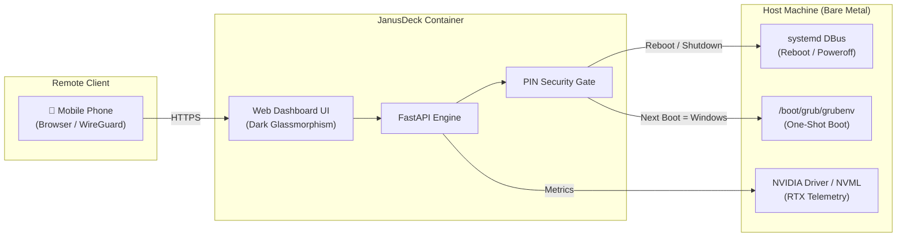

<div align="center">

# ⚡ JanusDeck

### The Open-Source Command Deck for Hybrid Gaming & Dual-Boot Home Servers

[](https://opensource.org/licenses/MIT)
[](docker-compose.example.yml)
[](https://fastapi.tiangolo.com/)
[](https://tailwindcss.com/)

*Switch between Linux Server and Windows Gaming from your phone. Monitor live GPU & CPU thermals, launch services, and control physical host power with a single tap.*

</div>

---

## 💡 Why JanusDeck?

Many homelab enthusiasts run high-performance PCs that serve a dual purpose:
1. **Server Mode**: Running Linux 24/7 for Docker containers, databases, and self-hosted services.
2. **Gaming Mode**: Dual-booting into Windows to utilize high-end GPUs for gaming sessions.

**The Problem**: Switching between operating systems traditionally requires sitting at your desk, rebooting, and hammering arrow keys on the bootloader screen. Furthermore, homelab dashboards (Homepage, Dashy, Homarr) are restricted to application bookmarks and lack host-level power controls.

**The Solution**: **JanusDeck** bridges the gap. It is a lightweight, mobile-responsive web dashboard deployed in Docker or bare-metal that gives you:
* 🎮 **One-Click OS Switching**: Switch from Linux to Windows using GRUB's one-shot reboot memory (`grub-reboot`). When you finish gaming and shut down Windows, the PC automatically boots back to your Linux server!
* 🛑 **PIN-Guarded Host Controls**: Graceful shutdown and reboot guarded by an authenticated master PIN.
* 📊 **Live Hardware Telemetry**: Real-time streaming of CPU load/thermals, RAM pools, NVIDIA GPU metrics (VRAM & temperatures), and disk pools.
* 🚀 **Unified Service Hub**: Central launcher for all your containers and self-hosted tools with live health check indicators.

---

## ⚡ Architecture



---

## 🚀 Quickstart

### 1. Clone & Configure
```bash
git clone https://github.com/your-username/janus-deck.git
cd janus-deck
cp config.example.yaml config.yaml
```

Edit `config.yaml` to define your service links, GRUB entry name (e.g. `Windows Boot Manager`), and your security PIN.

### 2. Deploy with Docker Compose
```bash
docker compose -f docker-compose.example.yml up -d
```

Open your browser at `http://<your-server-ip>:8080`.

---

## 🔒 Security First

* **PIN Protection**: Destructive power actions (Shutdown, Reboot, OS Switch) require confirming your PIN.
* **Auto-Revert Dual Boot**: When booting into Windows, JanusDeck sets GRUB's one-shot variable. Your server will **always** boot back into Linux on subsequent startups—you will never be locked out remotely.
* **Network Isolation**: JanusDeck can be restricted to your local network or WireGuard VPN.

---

## 📁 Repository Structure

```
janus-deck/
├── config.example.yaml          # Sample configuration (OS targets, services, PIN)
├── docker-compose.example.yml   # Production deployment template
├── docs/                        # Architecture & dual-boot setup guides
│   └── ARCHITECTURE.md
├── src/                         # FastAPI backend (telemetry & systemd bridge)
├── frontend/                    # Svelte 5 + TypeScript + Vite + Tailwind CSS SPA
├── .gitignore
├── LICENSE                      # MIT Open Source License
└── README.md
```

---

## 🗺️ Roadmap
- [ ] Core FastAPI backend with `psutil` & `pynvml` telemetry stream.
- [ ] Mobile-optimized glassmorphism dark UI with PIN keypad modal.
- [ ] Automated discovery of host GRUB boot entries (`grub-editenv`).
- [ ] Multi-OS switcher presets (Windows 10/11, Bazzite, TrueNAS, Fedora).
- [ ] Pre-built container images published to GitHub Container Registry (GHCR).
- [ ] 1-Click deployment template for Coolify.

---

## 📄 License
This project is licensed under the [MIT License](LICENSE).
